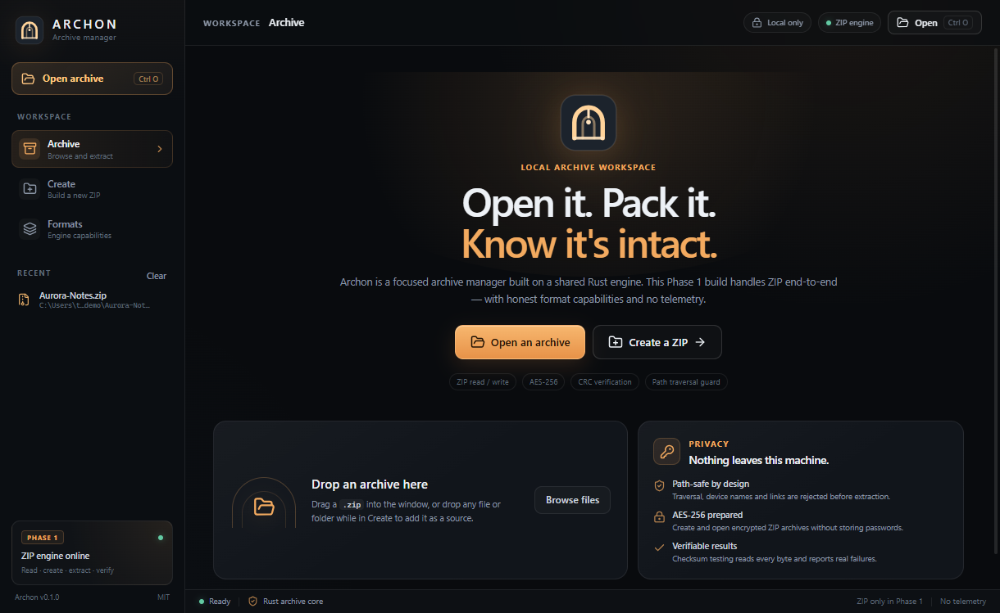
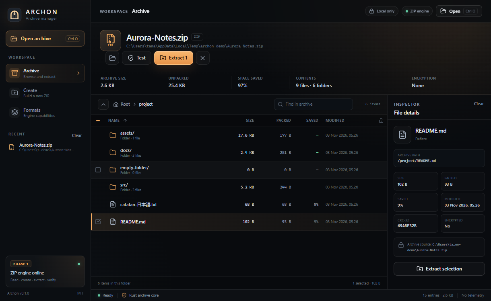
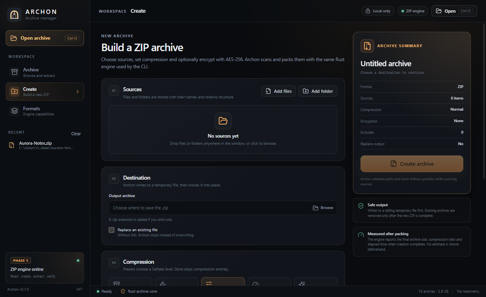
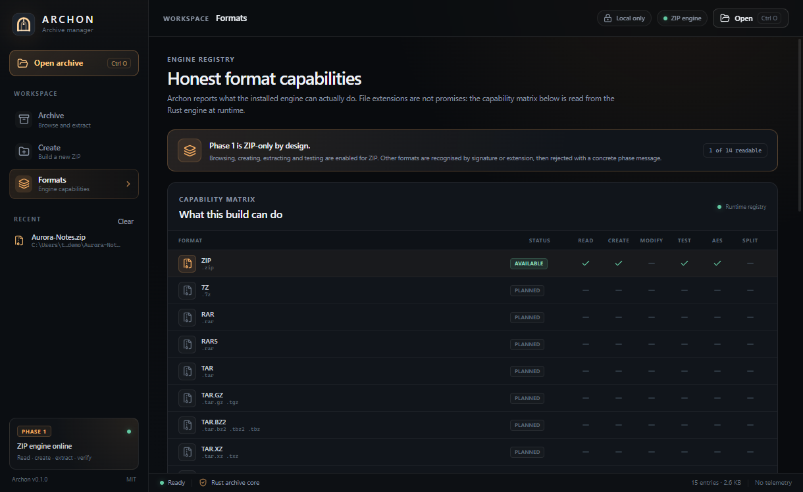
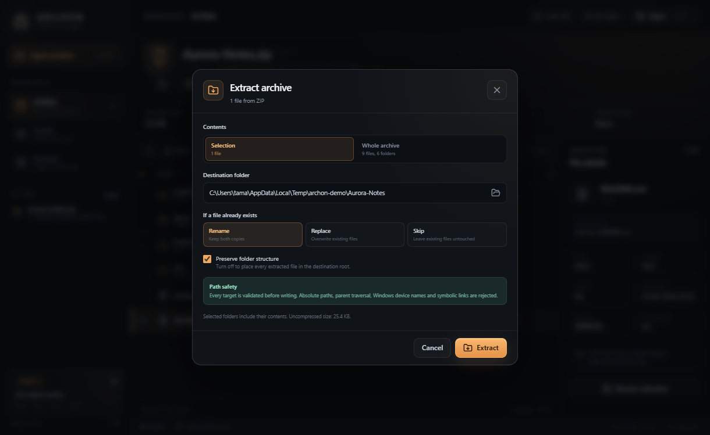

# Archon

Archon is an independent archive manager for Windows with a native desktop UI and a
scriptable command-line companion. It is built from scratch on Tauri 2, Rust and React —
no WinRAR code, branding, icons or other proprietary assets are used.

**Status: Phase 1 — ZIP is fully implemented.** Every format Archon cannot yet read or
create is labelled as such in the UI, the CLI and this document. Nothing is faked.

## What works today

| Capability | ZIP | 7Z | RAR / RAR5 | TAR family | GZ / BZ2 / XZ / ZST | WIM / ISO |
| --- | --- | --- | --- | --- | --- | --- |
| Browse / list | Yes | Recognised, planned | Recognised, planned | Recognised, planned | Recognised, planned | Recognised, planned |
| Extract | Yes | No | No | No | No | No |
| Create | Yes | No | **Never** (proprietary) | No | No | No |
| Test / verify | Yes | No | No | No | No | No |
| Add / remove entries | No | No | No | No | No | No |
| Split / multi-volume | No | No | No | No | No | No |

ZIP support includes:

- Store and Deflate compression, with presets from Store to Ultra (Deflate 1–9).
- AES-256 (AE-2) encryption when creating archives.
- Reading AES and legacy ZipCrypto archives; passwords can be retried in the UI.
- Folder trees, empty folders, CRC verification and comment display.
- Path-traversal protection, Windows reserved-name rejection, symlink skipping,
  decompression limits, disk-space checks and atomic (temp-file) extraction.
- Cancellable create, extract and test jobs with live progress.

> Archon will never create RAR archives. RAR extraction is planned for a later phase
> through a redistributable engine.

## Screenshots

Captured from the running Windows build (1220 × 800):

| Welcome | Archive browser |
| --- | --- |
|  |  |

| Create | Formats |
| --- | --- |
|  |  |



The interface is a charcoal/graphite workspace with amber-copper accents and three
views: **Archive**, **Create** and **Formats**.

## Requirements

- Windows 10 or 11 (WebView2 runtime is present on current Windows builds).
- [Rust](https://rustup.rs/) 1.88 or newer with the MSVC toolchain.
- [Node.js](https://nodejs.org/) 22 or newer (developed with Node 24) and npm.
- Visual Studio Build Tools with the “Desktop development with C++” workload.

## Build and run

```powershell
git clone <repository-url> archon
cd archon
npm install
npm run tauri dev        # development window with hot reload
npm run tauri build      # release build; installers land in target/release/bundle
```

The desktop application embeds the built frontend. Use the Tauri CLI so the production
`custom-protocol` feature is enabled; a plain `cargo build` targets the dev server
instead.

```powershell
npm run tauri build -- --debug --no-bundle   # runnable target/debug/archon.exe
```

### Frontend-only checks

```powershell
npm run check            # TypeScript, no emit
npm run build            # production frontend bundle
```

### Tests

```powershell
cargo test -p archon-core
```

The Phase 1 suite contains 17 tests: 4 unit tests for path validation and 13
integration tests covering round-trips, AES, traversal, collisions, corruption,
cancellation, overwrite policies and unsupported formats.

## Command-line usage

The CLI binary is `archon-cli` (`cargo run -p archon-cli -- …`, or
`target/release/archon-cli.exe` after a release build). It is intentionally named
differently from the desktop executable `archon.exe` so the two builds cannot overwrite
each other in a shared Cargo target directory.

```powershell
archon-cli list photos.zip
archon-cli info photos.zip
archon-cli create backup.zip .\Documents -p maximum
archon-cli extract backup.zip -o .\restored --overwrite rename
archon-cli test backup.zip
archon-cli list photos.zip --json
```

Useful `create` options: `--preset store|fast|normal|maximum|ultra`,
`--method store|deflate`, `--level 1-9`, `-x/--exclude <glob>` (repeatable),
`--force` to replace an existing output, `--encrypt` for AES-256.

Useful `extract` options: `--entry <path>` (repeatable; folders include their
children), `--overwrite overwrite|skip|rename` (default `rename`), `--flat` to
drop folders, `-o/--output <dir>`.

### Passwords

Passwords are **never accepted as command-line arguments**, because arguments are
visible to other processes and often end up in shell history.

```powershell
# Preferred: environment variable
$env:ARCHON_PASSWORD = "correct horse battery staple"
archon-cli create secret.zip .\private --encrypt
archon-cli extract secret.zip -o .\out
Remove-Item Env:\ARCHON_PASSWORD

# Or pipe a single line on stdin
Get-Content .\password.txt | archon-cli test secret.zip --password-stdin
```

On an interactive terminal, Archon prompts securely (input hidden) when a password
is needed and not supplied. Passwords are held in zeroizing memory and are never
written to logs or progress events.

## Desktop workflow

1. **Archive** — open a ZIP, browse the folder tree, search, select files and
   extract or test them. Unsupported formats open in the same view and display the
   engine's honest “planned” error instead of pretending to work.
2. **Create** — add files/folders (picker or drag-and-drop), choose a destination,
   preset, optional Deflate level, excludes and AES-256 encryption.
3. **Formats** — a live capability matrix read from the engine, so the UI cannot
   drift away from what the backend actually supports.

Recent archives are stored locally in `localStorage`; there is no telemetry,
account system or network access.

## Project layout

```
crates/archon-core/   Engine abstraction, ZIP implementation, security, limits
crates/archon-cli/    `archon-cli` command-line interface
src-tauri/            Tauri commands, state, capabilities, icons, bundling
src/                  React + TypeScript desktop UI
docs/                 Architecture, formats, security, installation, development
```

See [docs/architecture.md](docs/architecture.md) for the design and data flow.

## Roadmap

- **Phase 2** — TAR/TAR.GZ/TAR.BZ2/TAR.XZ, raw GZ/BZ2/XZ and 7Z via a
  permissively licensed engine; adding/removing ZIP entries.
- **Phase 3** — RAR/RAR5 extraction through a redistributable engine. RAR
  creation is permanently out of scope.
- **Phase 4** — Windows integration: Explorer context menu, file associations,
  installer polish and code signing.

Multi-volume archives are not supported in Phase 1.

## Security

Archon treats every archive as untrusted input. See [SECURITY.md](SECURITY.md) and
[docs/security.md](docs/security.md) for the threat model and safeguards. To report
a vulnerability, follow the private disclosure process in `SECURITY.md`.

## License

MIT — see [LICENSE](LICENSE). Third-party components are listed in
[THIRD_PARTY_NOTICES.md](THIRD_PARTY_NOTICES.md).

Archon is not affiliated with RARLAB, WinRAR, 7-Zip or any other archive tool.
